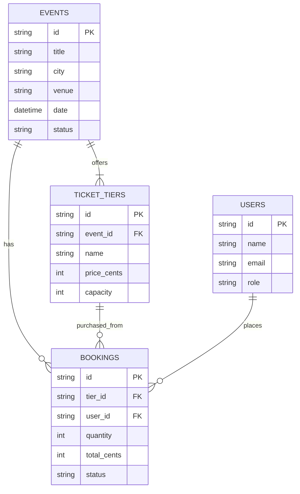
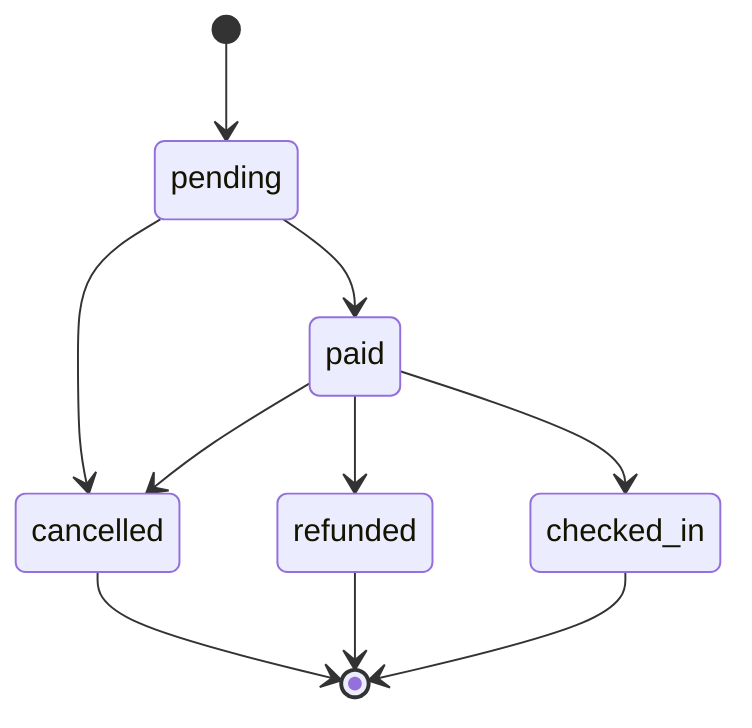

# Build 3 architecture

## Layers

```mermaid
flowchart TD
  Client --> Routes
  Routes --> Services
  Services --> Rules
  Services --> Repositories
  Repositories --> Database[(Database)]
```

- **Routes** may read HTTP input, call services, and format responses; they may not contain business rules or access storage directly.
- **Services** may coordinate domain rules and repositories; they may not depend on HTTP details or call routes.
- **Rules** may enforce business invariants and use domain data; they may not perform HTTP or file/database I/O.
- **Repositories** may load and save data; they may not decide business policy or call services/routes.

## Data model

## Booking life cycle

